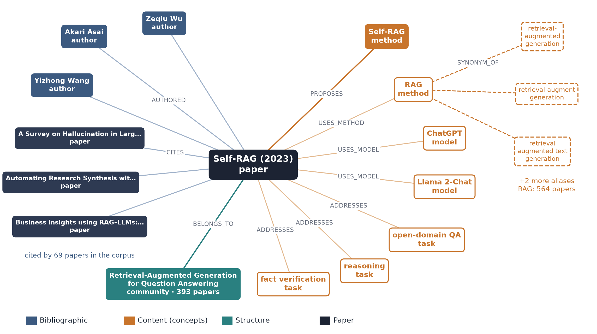
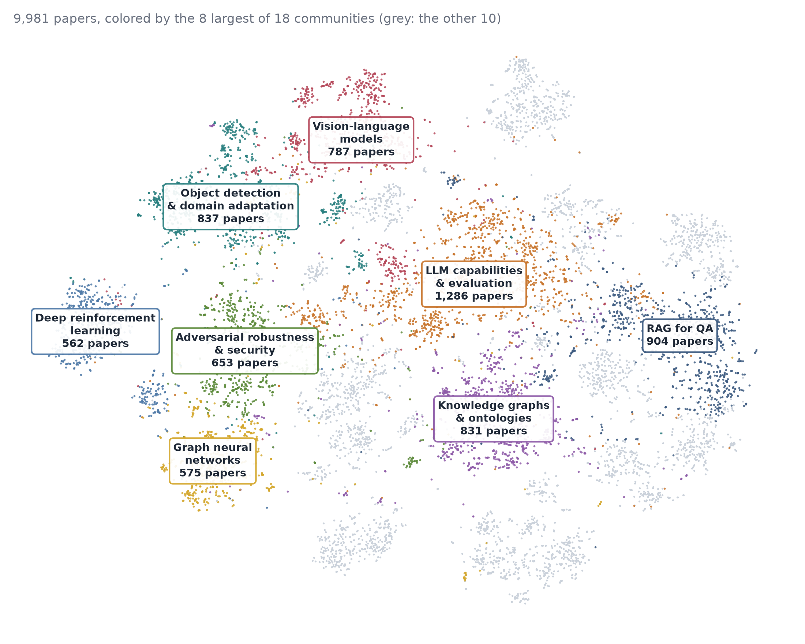

# Research Knowledge Graph of 9,981 AI Papers

A knowledge graph of AI papers (2022–2026, OpenAlex) that links papers, authors, citations, and the research concepts inside each paper (tasks, methods, models, datasets, metrics), with synonym links and paper communities. The design follows HippoRAG 2 (concepts and documents in one graph, synonym edges, Personalized PageRank search) and GraphRAG (community summaries as a map of the corpus).

| Papers | Nodes | Edges | Concepts | Synonym links | Communities |
|---:|---:|---:|---:|---:|---:|
| 9,981 | 101,549 | 346,774 | 34,353 | 2,670 | 18 + 42 |



## The graph

`exports/kg/nodes.parquet` and `exports/kg/edges.parquet`. Node ids look like `paper:W4387800173` or `method:rag`. `props` holds type-specific fields as JSON.

| Layer | Nodes | Edges |
|---|---|---|
| Bibliographic | Paper, Author, Institution, Venue, Topic | CITES, AUTHORED, AFFILIATED_WITH, PUBLISHED_AT, HAS_TOPIC, SUBTOPIC_OF |
| Content | Task, Method, Model, Dataset, Metric, Experiment | PROPOSES, USES_METHOD / MODEL / DATASET / METRIC, ADDRESSES, REPORTS, EVALUATED_ON |
| Structure | Community | SIMILAR_TO, SYNONYM_OF, BELONGS_TO |

```python
import pandas as pd
nodes = pd.read_parquet("exports/kg/nodes.parquet")
edges = pd.read_parquet("exports/kg/edges.parquet")
edges[(edges.rel == "PROPOSES") & (edges.dst_id == "dataset:ragtruth")]   # which paper proposed RAGTruth?
```

## How it is built

| # | Step | What it does |
|---|---|---|
| 1 | `collect` | Fetch candidate papers from OpenAlex with quotas per topic, query and year |
| 2 | `verify` | Check each record against arXiv, Crossref and DataCite; repair or drop corrupted records |
| 3 | `abstracts` | Replace or drop abstracts that belong to another paper |
| 4 | `select` | Fix the corpus and merge preprint and published versions |
| 5 | `build` | Paper, author, institution, venue and topic nodes; authors merged by ORCID and name |
| 6 | `s2_refs`, `arxiv_refs` | Add citations from Semantic Scholar and arXiv HTML reference lists |
| 7 | `extract`, `content` | gpt-4o-mini reads each title and abstract and returns typed concepts with a role (proposed or used); names not in the text and generic terms are dropped |
| 8 | `link` | Synonym links in three tiers: normalization, a corpus-built acronym dictionary, and embedding candidates accepted only when two LLMs agree |
| 9 | `similar` | bge-base embeddings; each paper links to its 10 nearest papers |
| 10 | `communities` | Leiden on citations, similarity and shared concepts (18 coarse, 42 fine communities) |
| 11 | `summarize` | gpt-4.1 names and summarizes each community from graph evidence only |
| 12 | `kg/retrieve.py` | Search: dense, graph (PPR), hybrid, community-routed |



## Rebuild

```bash
pip install -r requirements.txt
python -m kg.pipeline                     # every step after `collect`; about 3 minutes with one GPU
# or detached: scripts/kg.sh start configs/kg.yaml ; scripts/kg.sh status configs/kg.yaml
pytest -q
```

`data/raw/` holds the OpenAlex records and every cached API and LLM response, so the rebuild needs no API key and gives exactly this graph. Building a new corpus calls the APIs (copy `.env.example` to `.env`); LLM cost is about $5 per 10,000 papers. Settings are in `configs/kg.yaml`; `corpus.fixed_from: seed` starts from the paper sample in `data/processed/seed/`.

Search (after a rebuild):

```bash
python -m kg.retrieve "graph-based retrieval-augmented generation" --system dense --latest
python -m kg.retrieve "DTI prediction" --system hybrid
```

## Layout

```
kg/            pipeline (kg/steps/ one module per step, kg/sources/ API clients)
configs/       kg.yaml
scripts/       kg.sh (detached runs)
tests/         offline tests
data/raw/      OpenAlex records and cached responses
data/processed/seed/   the fixed paper sample
exports/kg/    the graph
```

## Data sources

OpenAlex metadata is CC0. arXiv, Crossref, DataCite and Semantic Scholar responses follow the terms of each service.
